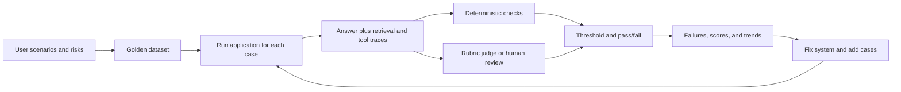
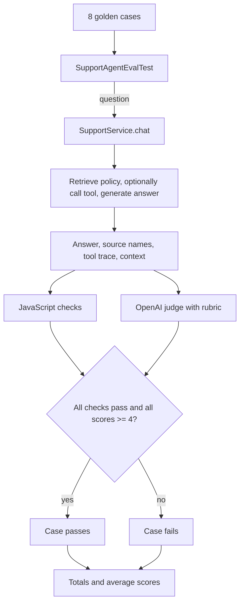
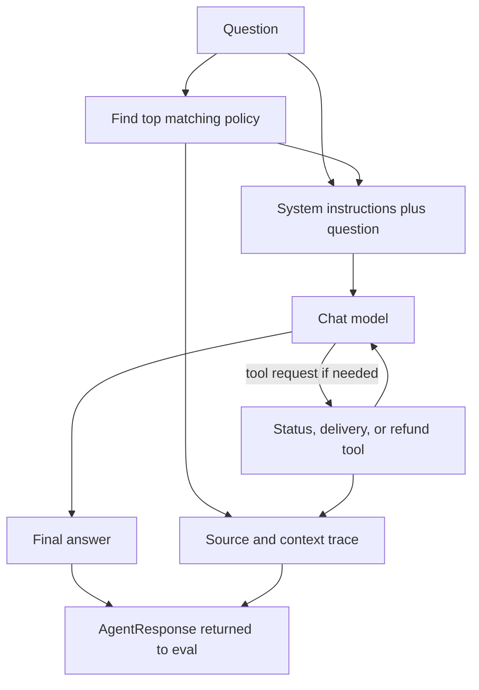

# AI Evals: What They Are and How This Project Uses Them

This README starts with AI evaluation (eval), not with Express. The project is a support-agent example used to show how to measure an LLM application's behavior against known scenarios. Express is only the way a user can call the application; the eval calls the application service directly.

## 1. What Is an AI Eval?

An AI eval is a repeatable experiment for answering questions such as:

- Did the application answer the user’s question?
- Did it use the right policy information or tool?
- Is its answer supported by the information it received?
- Did a code, prompt, model, or data change make quality worse?

Traditional unit tests often compare a function result with an exact expected value. LLM answers can express the same correct idea in different words, so exact string matching is often too strict. AI evals combine **deterministic checks** for facts the code can verify with **semantic evaluation** for answer qualities that need judgment.

An eval does not prove an AI system is always correct. It measures behavior on a deliberately chosen set of cases. The usefulness of the result depends on how representative and well-defined those cases are.

## 2. The Problem This Eval Addresses

This support agent receives two main kinds of questions:

- General company-policy questions, such as “How long does standard shipping take?” The answer should use a policy document.
- Specific order questions, such as “When will ORD-101 arrive?” The application should select the relevant order tool and use its result.

An LLM can produce a fluent but incorrect answer, select the wrong tool, use the wrong order ID, ignore retrieved policy, or state something unsupported. A happy-path manual check is not enough to catch regressions across all these behaviors.

The eval addresses that problem by saving representative questions and expectations in a golden dataset, running the real support service for each question, checking observable behavior with code, asking a separate LLM judge to score answer quality, then applying a pass threshold.

## 3. Common AI-Eval Workflow

There is no single universal eval framework or score used by every industry team. A common practical pattern is:

1. **Define tasks and risks.** Identify the important user scenarios and what failure would look like.
2. **Create a dataset.** Store representative inputs and expected outcomes in a version-controlled format.
3. **Run the system under test.** Call the application using the same important workflow users rely on.
4. **Capture evidence.** Keep the answer and useful traces such as retrieved sources, tool names, arguments, and tool results.
5. **Apply deterministic checks.** Use normal code for exact requirements such as tool selection, IDs, required fields, permissions, or source selection.
6. **Apply semantic checks where useful.** Use a rubric-based LLM judge or human review for qualities such as relevance, correctness, and faithfulness.
7. **Decide pass/fail and report.** Apply thresholds, show failures by case, and compare results after changes.
8. **Improve the suite.** Add real failures and important edge cases to the dataset; run the eval again after changing prompts, models, retrieval, tools, or application code.



## 4. How This Project Applies That Pattern

The eval implementation is `src/test/SupportAgentEvalTest.js`; its dataset is `src/main/resources/golden-dataset.json` and its judge rubric is `src/main/resources/judge-rubric.txt`.



### Cases currently covered

The dataset has eight cases:

| Behavior | Cases | What they exercise |
| --- | ---: | --- |
| Policy retrieval | 4 | Return policy (including a paraphrase), refund timing, and shipping timing. |
| One order tool | 3 | Order status, delivery estimate, and refund amount. |
| Combined policy and order | 1 | Return eligibility using both the return policy and order status. |

Each case contains `id`, `question`, `expectedAnswer`, `expectedBehavior`, `expectedTool`, `expectedToolArgument`, and `expectedSource`. `expectedAnswer` is evidence for the judge, not an exact-match assertion against the model's wording. `expectedBehavior` describes the desired meaning. Expected tool/source fields support exact checks.

### Checks and pass rule in this implementation

For every case, JavaScript checks:

- The response has a non-empty answer.
- If `expectedTool` is `null`, no tool was used; otherwise the expected tool appears in `toolsUsed`.
- If a tool is expected, its recorded argument matches `expectedToolArgument`.
- If an `expectedSource` is specified, it appears in `retrievedDocuments`.

The test then asks a separate OpenAI chat call to judge the answer using the case expectations, retrieved context, tool results, actual answer, and rubric. The rubric scores five dimensions from 1 to 5: relevance, correctness, faithfulness, helpfulness, and hallucination freedom.

A case passes only if **every deterministic check is true and every judge score is at least 4/5**. The test reports case-level results, the number passed/failed, and metric averages. It fails the test run if any case fails.

### Important coverage boundary

The current golden dataset does not include greeting cases, scraper fallback, real-time web questions, unknown order IDs, ambiguous input, or external-service failures. Those are sensible eval cases to add if those behaviors are part of the product. This codebase itself has no scraper: it uses local policy files and example order fixture maps. Do not treat the current eight passing cases as proof for behavior that is not represented in the dataset.

## 5. Application Being Evaluated

The support application gives the eval something real to measure. General policy questions use local policy retrieval; order-specific questions can use one of three tools. The app supplies this evidence to the eval:

- `answer`: the natural-language answer being evaluated.
- `retrievedDocuments` and `context`: what policy information was provided.
- `toolsUsed`, `toolArguments`, and `toolResults`: what actions the model requested and what came back.

The eval calls `SupportService.chat()` directly rather than making an HTTP request. This keeps the AI behavior evaluation focused on the service and avoids mixing it with unrelated HTTP concerns. Separate offline tests check the Express route, input validation, and response format.



This application uses local policy documents and an in-memory vector store. It does not contain a web scraper, production vector database, or live order database. Order data is represented by example maps in the tool files, so the example does not supply general real-time web data.

## 6. Codewise: What the Eval Does

The eval loop in `SupportAgentEvalTest.js` is conceptually:

```js
const failures = [];

for (const data of cases) {
  const evalCase = new EvalCase(data);
  const response = await supportService.chat(evalCase.question);

  const checks = {
    'Response exists': Boolean(response.answer?.trim()),
    'Correct tool': evalCase.expectedTool === null
      ? response.toolsUsed.length === 0
      : response.toolsUsed.includes(evalCase.expectedTool),
    'Correct tool argument': evalCase.expectedTool === null ||
      response.toolArguments[evalCase.expectedTool] === evalCase.expectedToolArgument,
    'Expected source retrieved': evalCase.expectedSource === null ||
      response.retrievedDocuments.includes(evalCase.expectedSource),
  };

  const judgeResult = await askJudgeForScores(evalCase, response, rubric);
  const passed = Object.values(checks).every(Boolean) &&
    metrics.every((metric) => judgeResult[metric] >= 4);
  if (!passed) failures.push(evalCase.id);
}

assert.deepEqual(failures, [], `Failed eval cases: ${failures.join(', ')}`);
```

`askJudgeForScores` is a descriptive placeholder for the judge prompt and `ChatClient.complete()` call shown in the test file. The actual eval spells that operation out inline. Step by step:

1. The test creates the real application and gets its `supportService` from `app.locals`.
2. It loads the JSON dataset and judge rubric from the resources folder.
3. For each dataset record, it creates an `EvalCase` and calls the service with that case’s question.
4. It checks answer presence, expected tool, tool argument, and expected retrieved source.
5. It builds a judge prompt containing the question, expected answer/behavior, retrieved policy context, tool results, actual answer, and rubric.
6. It calls a separate `ChatClient` in JSON mode to get the judge scores.
7. It validates that each score is an integer from 1 to 5, accumulates averages, and marks the case as passed or failed using the threshold.
8. It prints a per-case result and a summary; a final assertion fails the test if any case failed.

The LLM judge is not a replacement for normal assertions. Tool choice and source selection are objectively observable, so this project checks them with JavaScript. The judge is used for language quality and support grounded in context, where a simple exact string comparison would be brittle.

## 7. Run the App and Checks

Requirements: Node.js 20 or newer. The live application and AI eval require an OpenAI API key.

Install dependencies from this directory:

```sh
npm install
```

Set the key and start Express:

```sh
export OPENAI_API_KEY='your-api-key'
npm start
```

The default server address is `http://localhost:8080`. `OPENAI_CHAT_MODEL`, `OPENAI_EMBEDDING_MODEL`, and `PORT` can override defaults. The app reads environment variables directly and does not load a `.env` file.

Run the **offline HTTP tests**:

```sh
npm test
```

These inject a fake service and check Express routing, JSON response behavior, missing-message validation, and 404 handling. They do not call the LLM, embeddings API, or eval judge.

Run the **live AI eval**:

```sh
export OPENAI_API_KEY='your-api-key'
npm run eval
```

This embeds the policy files, runs the actual service for each golden case, and calls the judge model. It requires network access and can incur API usage. Model-generated answers and judge scores may vary between runs.

## 8. HTTP Example (Supporting Context)

The Express API is how a person can try the system manually; it is not the eval itself. Check server health:

```sh
curl http://localhost:8080/health
```

Ask a question:

```sh
curl -X POST http://localhost:8080/chat \
  -H 'content-type: application/json' \
  -d '{"message":"When will ORD-101 arrive?"}'
```

The chat controller also accepts `message` as a query parameter or URL-encoded form field. A response includes `answer`, `retrievedDocuments`, `toolsUsed`, `toolArguments`, `toolResults`, and `context`. Exact answer wording can differ from the illustrative expected answer.

## 9. What Teams Commonly Add for Production Evals

The simple example teaches the core loop. A fuller team eval suite often also:

- Adds cases from real user reports and important edge cases, with privacy-safe data.
- Separates offline deterministic tests from live external-service integration evals.
- Uses fixed test fixtures or recorded responses when reproducibility matters.
- Tracks latency, token usage, cost, retrieval quality, and tool errors alongside answer scores.
- Compares a new prompt/model/build with a saved baseline instead of looking only at one aggregate average.
- Reviews judge prompts and scores against human-labeled examples; uses human review for high-impact decisions.
- Keeps failures inspectable by case and does not hide a broken category behind a high overall average.

There is no single universal industry “AI eval standard.” The broadly useful practice is to define representative tasks, save expected behavior, measure observable outcomes, combine hard checks with semantic review where needed, inspect failures, and rerun after changes.

## 10. Extending the Eval

To add a policy case, add an item to `golden-dataset.json` with the question, expected behavior, and expected source. For a tool case, specify the expected tool and argument. Add cases for greetings, scraper fallback, missing information, and errors only after implementing those behaviors in the application.

When adapting the pattern to another project, keep the eval lifecycle but change the cases and checks to fit that product. For example, a classifier checks labels; a search system checks relevant documents; this support agent checks retrieved policy sources and tool traces. The test dataset and the definition of “correct” are always project-specific.

## 11. Limitations

- This is a learning demo, not production-ready customer support software.
- Order tools read fixed example data, not a live order database.
- The vector store is in memory, retrieves only one policy document, and re-embeds policies at startup.
- There is no scraper, authentication, rate limiting, persistent conversation history, or production observability.
- A judge model can be inconsistent. Keep important business requirements as deterministic checks wherever possible.
- Never expose API keys in source code or commit them to version control.
